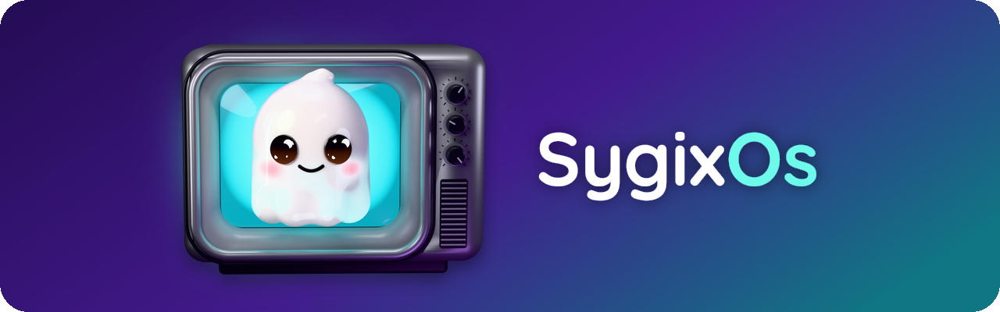

<h1 align="center"></h1>

[](https://github.com/Sygix/SygixOs/actions/workflows/test.yml)
[](https://github.com/Sygix/SygixOs/releases)
[](LICENSE)

A free and open source launcher for Android TV / Google TV, inspired by tvOS 26: dark Liquid Glass, polished focus and animations, the Figtree typeface, **no ads**. It showcases the content published by your installed apps (Jellyfin, Netflix, Prime Video…) through the Android TV Provider, without a launcher account or a backend. An optional BetaSeries account adds shared watch tracking.

> Independent project, not affiliated with Apple, Google or TCL. Apple TV and tvOS are trademarks of Apple Inc.; Android TV and Google TV are trademarks of Google LLC.

## Your TV, without the clutter

An immersive home screen, fluid navigation, and your apps where you want them. See SygixOs in this **41-second presentation** (French · Full HD · 60 fps).

https://github.com/user-attachments/assets/5f70ce5f-76bd-4901-baad-af92669b23b2

Music: **“Electric Dreams” by Scott Buckley**, released under [CC BY 4.0](https://creativecommons.org/licenses/by/4.0/) — [www.scottbuckley.com.au](https://www.scottbuckley.com.au/library/electric-dreams/). Edited excerpt with original sound effects. Nature footage and demonstration artwork: [Pexels](https://www.pexels.com/license/).

## Features

- **Startup splash**: on a cold start, the SygixOs ghost mascot floats and blinks alone on a black background, then crossfades into the hero. Never shows on return. Respects the system's animation setting.
- **Full-screen hero**: a muted slideshow of the programs published by your installed apps (continue watching, new releases, recommendations), with preview video when available. Source app and label above the title, details and progress bar below, readable on any poster.
- **À suivre**: a single row combining Watch Next from all your apps, deduplicated, with opened content first and removal per series or movie.
- **BetaSeries tracking (optional)**: connect from the TV with a code and QR, combine aired unwatched episodes and watchlist movies with local programs, choose a shared player and manage watched status from the content menu.
- **Dock and app grid**: apps detected automatically, 16:9 banners, tvOS-style focus, up to 6 pinned apps, reorderable grid.
- **Dark glass**: translucent glass with live blur on the dock, capsule, context menu and move-mode banner.
- **Top Shelf preview**: artwork appears above an app tile after a short hover and pans once.
- **Clock and settings capsule**: time and settings gear in a small glass capsule at the top right of the hero.
- **Settings**: choose source apps, hide and restore apps, manage removed content, show and place À suivre, turn off the slow zoom of the hero and Top Shelf visuals (“Mouvement des visuels”) for a still home screen on modest TVs, choose the interface language, version and licenses, check for updates.
- **System launcher**: guided setup to make SygixOs your home screen, automatic or by permissions, with restore before uninstall.
- **Self-update**: daily background check, signaled by a blue dot; nothing downloads without your consent.
- **Never a black screen**: falls back to nature clips, then a settling gradient.
- **Five languages**: English, French, German, Italian and Spanish. SygixOs follows the TV's language by default (English when it isn't translated), and Settings › Language sets another one for SygixOs only.
- **Fully local**: no backend, no telemetry, no hard-coded app list.

## Roadmap

### Available now

- **Launcher core** — app grid, dock, dark glass design system, tvOS-inspired focus and animations
- **Home hero** — full-screen slideshow of the content published by your apps, with preview video, source attribution and progress
- **À suivre** — unified Up Next row across all apps, with opened-first ordering and removal
- **Settings** — source apps, hidden apps, language, about, updates
- **Languages** — English, French, German, Italian and Spanish, following the TV's language by default
- **Startup splash** — animated mascot on cold start
- **Built-in updates** — check, download and install new versions from GitHub
- **System launcher setup** — guided setup to make SygixOs your home screen, automatic or by permissions
- **Simplified home setup** — [Tsuyu](https://github.com/Sygix/Tsuyu)-based automatic setup and repair for non-technical users
- **BetaSeries tracking** — optional device association, shared watchlist and player choice, watched actions and manual completion confirmation

### Coming next

- **Search**
- **Remote button remapping**

Detailed requirements for each feature live in [`openspec/specs/`](openspec/specs), and ongoing changes in [`openspec/changes/`](openspec/changes). Follow-ups deferred after v0.0.1, not specified yet, are tracked in [`openspec/backlog.md`](openspec/backlog.md). Specs are written in French; the interface is available in English, French, German, Italian and Spanish.

## Requirements

- Android TV or Google TV on **Android 14 or later** (minSdk 34)
- Tested on a TCL Google TV (Android 14)

## Installation

1. Download `app-release.apk` from the [Releases](https://github.com/Sygix/SygixOs/releases) page.
2. Send it to your TV and install it:
   - with [LocalSend](https://localsend.org) or "Send Files to TV" from your phone, or
   - by opening the release page in the TV's browser.
   Accept the install from an unknown source when Android asks.
3. On first launch, grant the "TV programs" permission (`READ_TV_LISTINGS`). Without it, the hero cannot see other apps' content.

**Startup profile (optional)**: `app-release.dm` compiles the app for a fast start. Install it with the APK if your installer supports multiple files; otherwise the APK works alone.

**Via ADB (advanced)**:
```
adb connect <TV-IP>:<port>
adb install-multiple app-release.apk app-release.dm
```
Check: `adb shell dumpsys package fr.sygix.sygixos | grep status=` → `[status=speed-profile]`.

**Later updates** install from the app: Settings → About → "Vérifier les mises à jour" → "Mettre à jour vers X". The download continues in the background; reopen SygixOs if it does not relaunch. Android may ask once to allow SygixOs to install unknown apps.

**Home screen setup**: at first launch, a panel offers up to three ways to make SygixOs your home screen. The preselected button is the recommended next step; pressing OK all the way through completes a setup that keeps the Google TV home and every remote key. Automatic steps show "Étape X sur N".

- **With Tsuyu** (recommended, when a release is available): [Tsuyu](https://github.com/Sygix/Tsuyu) is a privileged service by the same author. SygixOs downloads and verifies `tsuyu.apk` from Tsuyu's releases, then walks you through starting it and authorizing SygixOs. USB debugging stays on; relaunching or restoring no longer needs re-enabling it. Automatic repair runs silently when the Home-key service is blocked or boot opening was not observed.
- **Without Tsuyu**: enable developer options and USB debugging, then follow the prompts. SygixOs connects to the TV's own ADB, grants the manufacturer's auto-start operation when present, and defines the HOME role.
- **By permissions**: "Ouvrir SygixOs avec la touche Home" and "Ouvrir SygixOs à l'allumage" toggle the accessibility and boot-opening routes. The manufacturer's auto-start row appears only when its manager is installed.

When needed, setup asks "Un dernier choix": keep the Google TV home (preselected) or disable it, with a confirmation of what is lost. A different Android user keeps the original home. Failed partial operations roll back. "Détails" lists every change and its state.

Some TVs expose no network ADB port: automatic setup then says "Indisponible sur cette TV" and the permission route stays usable. Without Tsuyu, disable debugging after success; re-enable it to rerun setup.

**Restore before uninstalling**: use "Rétablir l'accueil Google TV". Without it, uninstalling can leave only an empty system fallback home. If SygixOs is unusable, the manual ADB recovery is:
```
adb shell pm disable-user --user 0 com.google.android.tungsten.setupwraith
adb shell pm disable-user --user 0 com.google.android.apps.tv.launcherx
adb shell cmd package set-home-activity --user 0 fr.sygix.sygixos/.ui.MainActivity
```
Reverse order restores the stock home; a factory reset is the last resort.

## Navigation

Remote control (D-pad) only, three tiers: hero → dock (pinned apps, at the bottom of the hero) → grid. The home screen is a single page: the hero fills the first screen, with the dock and the clock and settings capsule on it, and the grid sits below. Going from the dock to the grid scrolls the page in one continuous move: the hero, the dock and the capsule slide out at the top while the grid comes up, back to where you left the grid. Up from the first row, or Back, scrolls back.

- **Down / Up**: switch tiers; only the active zone takes focus.
- **Left / Right**: stay within the zone (previous or next program on the hero).
- **Up from the hero**: settings gear (the clock never takes the focus); Back from the gear returns to the hero button.
- **Back**: returns to the hero.
- **Long press OK** on a tile opens a dark menu (Up / Down to choose, Back to close):
  - pin to or unpin from the dock;
  - "Move" to reorder the grid with the arrows (OK confirms, Back cancels);
  - "Hide".

## How the hero works

The hero reads the programs apps publish to the TV Provider (`content://android.media.tv`, watch next and preview programs), and opens each item through the intent provided by the app. It reloads every time you return to the launcher.

- **Artwork validated before display**: a preview video, or an image or video at least 1080 px wide. A program without suitable artwork is left out of the slideshow.
- **Progressive validation**: the TV Provider can hold hundreds of programs, so only the first hero visuals are validated at startup, and an app's posters once the focus rests on its tile for half a second.
- **Text follows the picture**: the title, details and button change together with the picture, never before it. A program whose picture is not ready within 1 s (some apps serve their pictures slowly through their own content provider) is skipped; its picture keeps loading in the background and the program comes back once it is ready.
- **Optional fields**: the program type (`watch_next_type`), season and episode numbers, duration and playback position are all optional; whatever an app leaves out is simply not shown.
- **Instant startup**: the app catalog is cached.

## BetaSeries watch tracking

Open Settings → **Suivi de visionnage** → **Connecter BetaSeries**. On your phone or computer, open the complete address shown on the TV and enter its code, or scan the QR. The QR and text use the same address, including its path. Closing the panel cancels that association attempt; an expired code requires a new attempt. No password or application secret is entered on the TV.

If BetaSeries or secure storage is temporarily unavailable, your saved connection is kept. **Réessayer** in tracking settings or the home error details restores it without a new code or QR, even if the account name has not loaded yet. Returning to the launcher retries failed account reads after one minute. **Reconnecter BetaSeries** is reserved for an explicit token refusal; a generic HTTP error does not expire your session. A confirmed missing or unusable encryption key requires a new association.

The account contributes to the existing **À suivre** row and the hero, independently of the TV-program permission. The row still shows at most 20 cards; the hero can consider account content beyond that limit. Account data is cached durably and patched per content: mutations reread only that content. Local identities are cached per content. A complete refresh happens on connection or on foreground return once the last successful refresh is at least 15 minutes old, or the last partial or failed read is at least one minute old, without idle polling. A failed page or item does not remove other valid content and local content stays enriched; only explicitly refused access removes the account contribution and requires reconnection. Sync status and retry remain available even when À suivre is hidden.

After the first successful load, cached movies and series remain available after an offline restart. Each series keeps its current aired unwatched episode and five aired unwatched successors, crossing seasons where necessary, or fewer when the available end is confirmed. Marking watched/unwatched first saves the intention on this TV and updates the shared hero/row projection. **Enregistré sur la TV · En attente de synchronisation** is a local save, not a remote confirmation. An exhausted offline reserve waits for the network; it does not prove the series is up to date. Artwork follows its existing independent cache limits and may fall back to placeholders; videos are not downloaded.

Android WorkManager resumes pending watched/unwatched intentions in the background with connected-network constraints and spaced retries. Standby, reboot and Android force-stop rules can delay execution; force-stopping the app requires reopening it before Android allows its work to resume. **Synchroniser** reuses the same durable queue. Uncertain sends are checked before replay, and a failed reserve refill does not resend a confirmed mutation. Confirmed intentions and consumed entries are cleaned up once no undo or known local-resume reference needs them; this is not an unlimited viewing history. Adding, removing and archiving content still require their existing remote confirmation.

- **Player**: the first opening asks which installed app to use, even when there is only one recognized video app. Apps are ordered: apps publishing this content locally, apps matching services confirmed for the country, apps matching other mentioned services, the remaining video apps alphabetically, then **Autre application**, which lists the other launchable apps; focus starts on the first one. The choice is shared by the hero and À suivre, remembered per series or movie, and can be changed through **Ouvrir avec…**. An absent player prompts for a new choice. A published intent is used only for its exact target; otherwise opening the app is explicitly announced. Installing an app proves neither a subscription nor access to the content.
- **Country and availability**: confirm or change the country in the native settings dropdown. The content's service identifiers are checked against BetaSeries' list for that country, without reloading the account. Service confirmation does not guarantee an episode or subscription; other offers remain **Disponibilité non confirmée**. Missing offers never hide an eligible title.
- **Watched status**: the content menu offers watched/unwatched actions and, for a series, **Choisir un épisode**. Opening that list changes nothing. Marking an episode never implicitly marks earlier episodes. After returning from a player without reliable completion evidence, **Terminé ?** asks for confirmation; ignoring it never marks the content watched.
- **Undo**: locally saved watched/unwatched actions and confirmed archive actions offer **Annuler**. An unsent watched action can be cancelled locally; an action already sent is reversed through a new durable intention, restoring a movie's exact previous state. A remote removal is held for 10 active seconds before sending; focus on the notification, open settings or leaving the foreground pauses the remaining time. Cancelling during that window sends no removal. Disconnecting or stopping the process before sending abandons that removal, while watched/unwatched intentions survive process death; re-adding a remotely removed title is not promised to restore its history.
- **Remote access to the notification**: from the hero, press Up to the settings gear, then Right. From the grid, Back → Up → Right reaches the same notification without automatically taking focus. Left, Up or Back returns to the gear. When no notification is present, the same route opens an unavailable-tracking detail if needed.
- **Manual completion only**: returning from a player offers **Terminé ?** for the requested content. No watched status changes without confirmation. P9 neither requests notification/media-session access nor marks playback complete automatically. The prompt has no timer; a new tracked launch, dismissal, disconnect or confirmed watched status clears it. A pending **Annuler** never hides it: the finished undo is replaced, or a pending removal or running action completes first, then the prompt appears. A slow player still counts as opened when the launcher pauses within 15 seconds.
- **Three distinct operations**: **Retirer d'À suivre** hides the whole series or movie locally, across row sources, and excludes its BetaSeries hero candidates; restore it under **Applications cachées**. **Archiver la série** changes the account, while an existing local resume may remain. **Retirer du compte** removes remote membership after the undo window. Local hiding and restoring never mutate the remote account.

Disconnecting invalidates the session, clears its local account cache and pending intentions, stops its work and attempts to revoke that session remotely. Unsynced changes are lost on explicit disconnect or a switch to another account; reconnecting after an access refusal preserves them when the confirmed account is the same. Player preferences and local hides remain on the TV. The token is encrypted with Android Keystore; the dedicated tracking database and encrypted session are excluded from transferable backups. Downgrading to a version without offline tracking cannot synchronize this queue and does not constitute a remote confirmation.

Data and attribution: [BetaSeries](https://www.betaseries.com/). The official web client's configuration is discovered as static data, cached outside backups for seven days and invalidated on explicit refusal. Discovery is limited to the official page and six official scripts within 30 seconds; a format change exposes unavailability rather than an embedded fallback key. Real-TV compatibility and authenticated mutation checks remain part of validation, not a promise of universal playback support.

## Building from source

Requirements: JDK 21, Android SDK with platform and build-tools 37.
```
./gradlew testDebugUnitTest      # JUnit / Robolectric tests
./gradlew assembleRelease        # APK to test on the TV
./gradlew dexMetadataRelease     # its startup profile, app/build/outputs/dexmetadata/release/app-release.dm
```
Without a local SDK, use a throwaway container (Docker or Podman; amd64 is required because adb and aapt2 are x86_64):
```
docker run -d --name sygixos-build --platform linux/amd64 -v "$PWD":/work -w /work \
  -v sygixos-gradle:/root/.gradle ghcr.io/cirruslabs/android-sdk:34 sleep infinity
docker exec sygixos-build sdkmanager "platforms;android-37.0" "build-tools;37.0.0"
docker exec sygixos-build ./gradlew testDebugUnitTest assembleRelease
```
On Fedora or any other SELinux system, add `:z` to the mount (`-v "$PWD":/work:z`). Give the container about 4 GB of memory. Run `./gradlew --stop` before a build session, so leftover Gradle daemons don't get the build killed.

**Performance:** the `debug` build interprets bytecode and stutters on the TV. Always judge smoothness on `assembleRelease` (R8). To measure next to an installed release, `./gradlew assemblePerf` builds `fr.sygix.sygixos.perf` ("SygixOs perf"): same R8 build signed with the debug key, not declared as a home app, profileable from the shell; `./gradlew dexMetadataPerf` builds its startup profile (`app/build/outputs/dexmetadata/perf/app-perf.dm`, install both with `adb install-multiple`); launch it with `adb shell am start -n fr.sygix.sygixos.perf/fr.sygix.sygixos.ui.MainActivity` and measure with `adb shell dumpsys gfxinfo fr.sygix.sygixos.perf`. CI never builds or publishes it. The `perf` variant is for measurements only: its built-in update always ends in an error (its debug signature does not match the release), which is expected.

**Signing:** signing keys come from the environment (`SYGIXOS_STORE_FILE`, `SYGIXOS_STORE_PASSWORD`, `SYGIXOS_KEY_ALIAS`, `SYGIXOS_KEY_PASSWORD`). Without these variables, the debug key is used.

**Releases:** a `vX.Y.Z` tag (or `vX.Y.Z-alpha.N`, `-beta.N`, `-rc.N`) triggers the `release` workflow. It builds, tests, signs and publishes the APK and its startup profile (`app-release.dm`) to a GitHub release; the `versionCode` is derived from the tag.

## Contributing

Contributions are welcome, through issues or pull requests.

- **Spec first**: every feature or behavior change starts with an [OpenSpec](https://github.com/Fission-AI/OpenSpec) proposal in `openspec/changes/<id>/`, approved before implementation. Project context and authoring rules: [`openspec/config.yaml`](openspec/config.yaml).
- **Conventions**: [`AGENTS.md`](AGENTS.md) (in French) applies to humans and AI agents alike. In short:
  - uniflow architecture (ViewModel → StateFlow → Compose), no logic in composables;
  - no code comments;
  - AGPL license header on every file;
  - D-pad navigation tests at TV screen size.
- **Git**:
  - `feat/`, `fix/`, `chore/` branches;
  - [Conventional Commits](https://www.conventionalcommits.org/) in English;
  - signed commits;
  - green CI (`./gradlew test`).
- **Validation**: run `openspec validate --all --strict` before opening a PR.

## Project layout

```
app/          Android app: core/ (design system), data/, domain/, model/, ui/
openspec/     current specs (specs/), changes (changes/), deferred follow-ups (backlog.md), rules (config.yaml)
.github/      CI (test) and release publishing (release)
```

## Stack

Kotlin 2.4 · Jetpack Compose (BOM 2026.09) · Haze 2 (Liquid Glass) · media3 (ExoPlayer) · Coil · Room · DataStore · JUnit / Robolectric

## License

SygixOs is licensed under the [GNU AGPL-3.0-or-later](LICENSE). Third-party library licenses are listed in the app (Settings → About). The fallback nature clips are streamed from [Pexels](https://www.pexels.com/license/).
